# AVA Zaxxon

[](https://github.com/Harlock123/AVAZaxxon/actions/workflows/build.yml)

An isometric space shooter in the style of Sega's 1982 arcade game **Zaxxon**, built with .NET 10 and
Avalonia UI. The fortress scrolls past at an angle beneath your ship. Fly through the holes in its
walls and under its force fields, shoot its guns, radar and fuel tanks, and beat a squadron of fighters
in open space. At the heart of the fortress, bring down the Goliath robot before its homing missile
brings you down.

## Features

- **Flying in three dimensions** on a flat screen:
  - **Moving:** the ship flies forward on its own. You slide it across the deck, climb and dive.
  - **Your shadow:** it falls on the deck straight below you. Your shots only hit what is at your height and in your line, so the shadow is how you aim at the ground.
  - **The altimeter:** it shows your height down the left of the screen. A green band marks how low you must be to get through the next wall or field.
- **The fortress**:
  - **Walls:** brick walls with a hole in each. Line up with the hole and get below its lintel.
  - **Force fields:** crackling fields between two pylons, to be flown under.
  - **Guns:** turrets that lead their shots at you.
  - **Rocket silos:** they launch as you come over them.
  - **Targets:** radar dishes, parked planes, and fuel tanks.
- **Fuel**: it burns all the way over the fortress, and running dry brings you down. Shooting a fuel tank tops it up. A gauge shows what's left, and a beep warns when it runs low.
- **Open space**: between the outer and inner fortress, a squadron of fighters comes at you, edging towards your height and your line and shooting. With no deck below, a faint grid and drop lines to it show how high everything is. A counter shows how many fighters are left.
- **The Goliath**: a robot that walks backwards ahead of you at the end of the inner fortress, swaying from side to side.
  - **Its launcher:** the muzzle on its arm glows as its missile charges. Hit it six times to bring the robot down. Shots anywhere else clang off.
  - **The missile:** it homes in on you, but you can shoot it down.
- **Levels**: each one is the fortress, open space, the inner fortress and the Goliath. Every level is faster, with more guns, narrower holes and quicker missiles. The fortresses are laid out the same every game, so they can be learnt.
- **Scoring**:
  - Fuel tanks 300, guns 200, radar 1000, planes 50, silos 150, rockets 200
  - Fighters 150, the homing missile 500
  - Each hit on the launcher 200, and the Goliath itself 3000
  - An extra ship at 10,000 points and every 20,000 after that
- **Sound**: an original flying march in E minor, shots, explosions, the fuel chime and warning beep, rocket launches, the robot's alarm and its missile. All of it is synthesised and mixed by OpenAL.
- **Attract mode**: leave the title alone for 15 seconds and a computer pilot flies. It lines up with each wall's hole, ducks under the fields, hunts fuel when the gauge is low, dodges shells, and goes for the launcher.
- **A top-ten high-score table** with arcade-style initials entry. It records the level reached.
- **Gamepads** through SDL2, as well as the keyboard.
- **Any window size**: the screen scales to fit, letterboxed. **Ctrl+S** saves a screenshot.
- **One self-contained executable** per platform: Windows, macOS and Linux on Intel/AMD and ARM.

## Screenshots

| The title | Into the fortress | Through the wall |
|:---------:|:-----------------:|:----------------:|
| 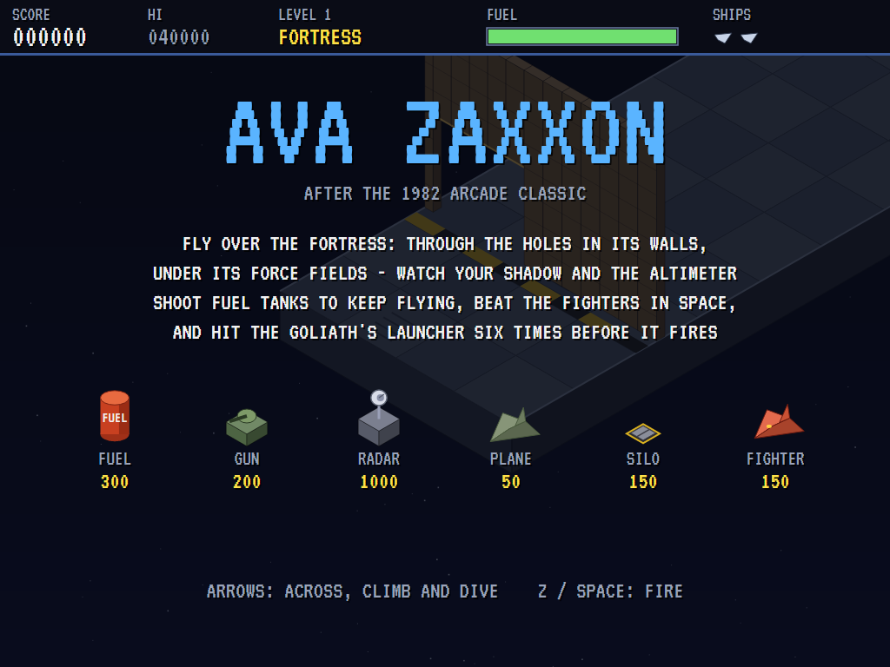 | 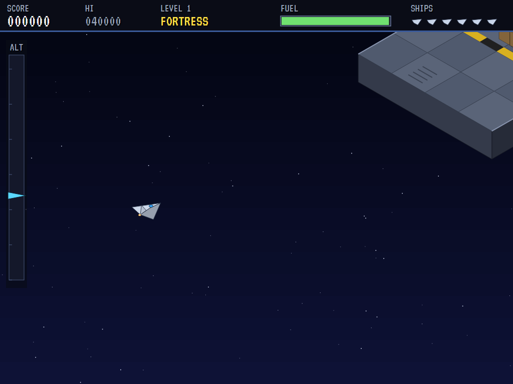 | 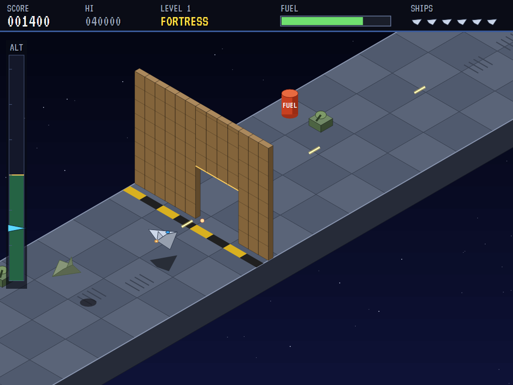 |
| What everything is worth. | The gate, dead ahead. | Lined up with the hole, under the lintel. |

| A force field | Gunfire | Open space |
|:-------------:|:-------:|:----------:|
| 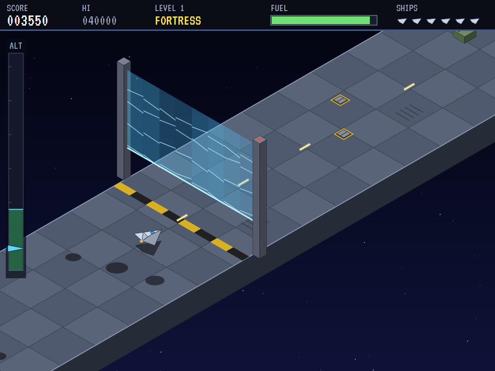 | 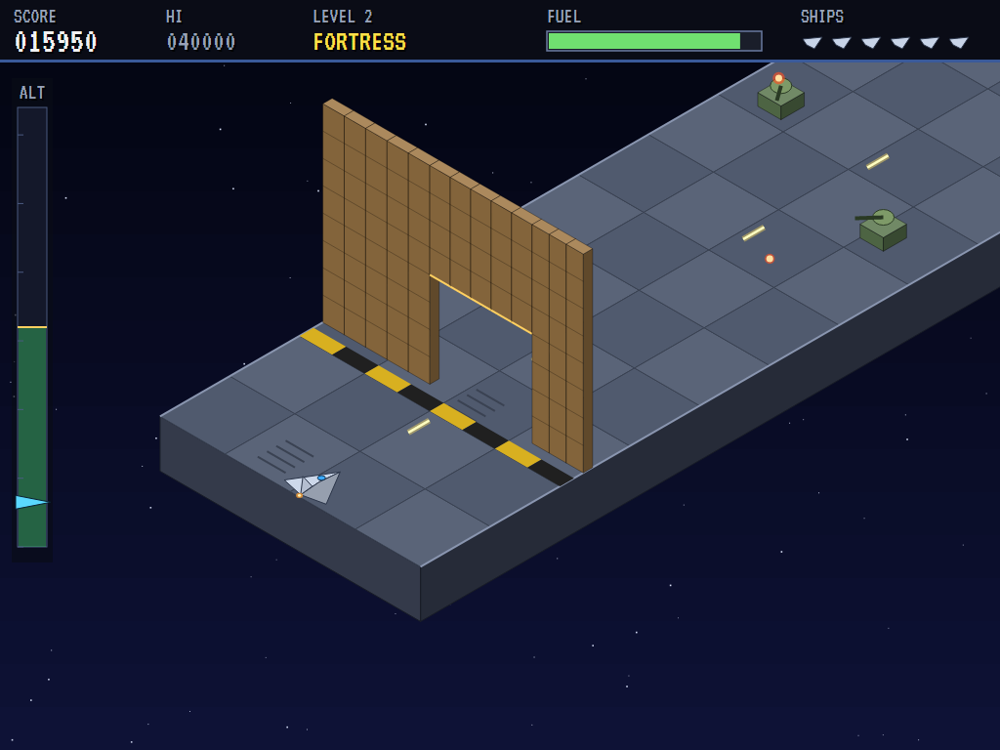 | 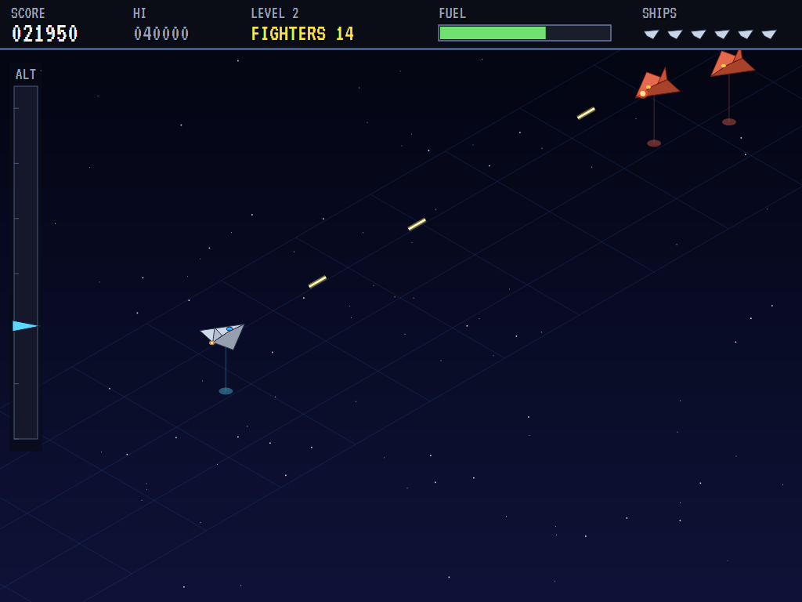 |
| Under it, low on the altimeter. | Shells coming back. | Fighters at their own heights. |

| Fuel | The inner fortress | The Goliath |
|:----:|:------------------:|:-----------:|
| 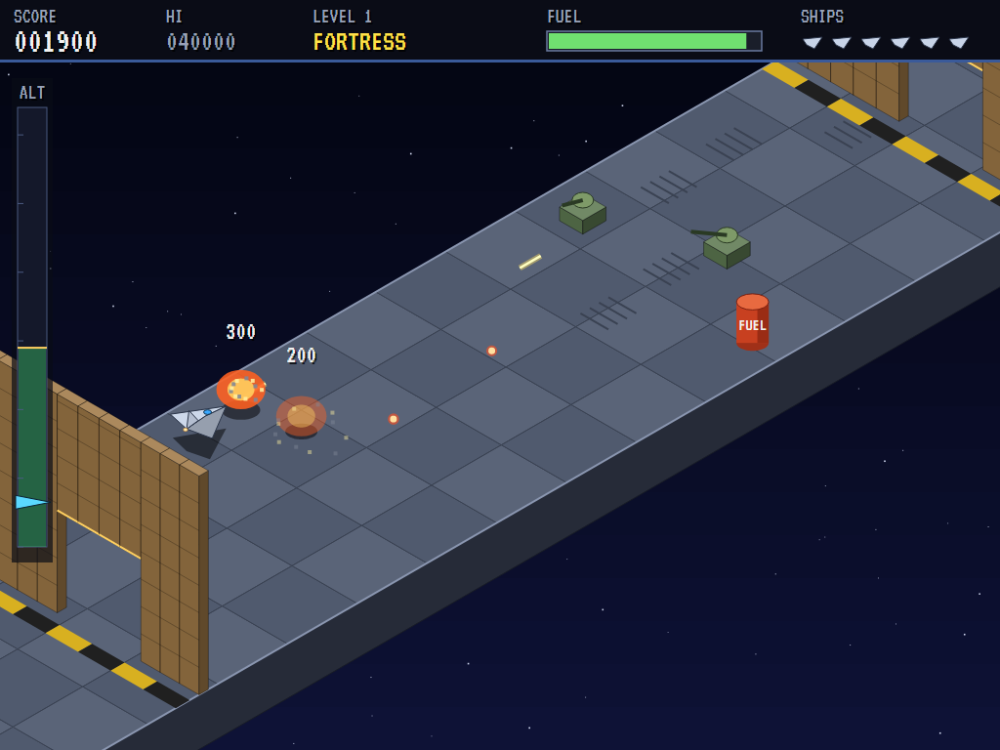 | 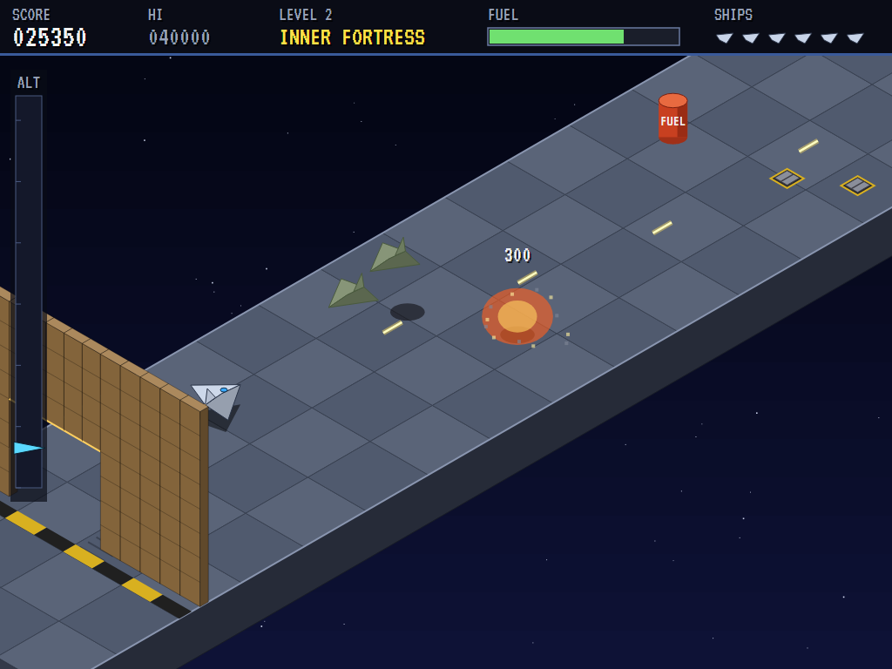 | 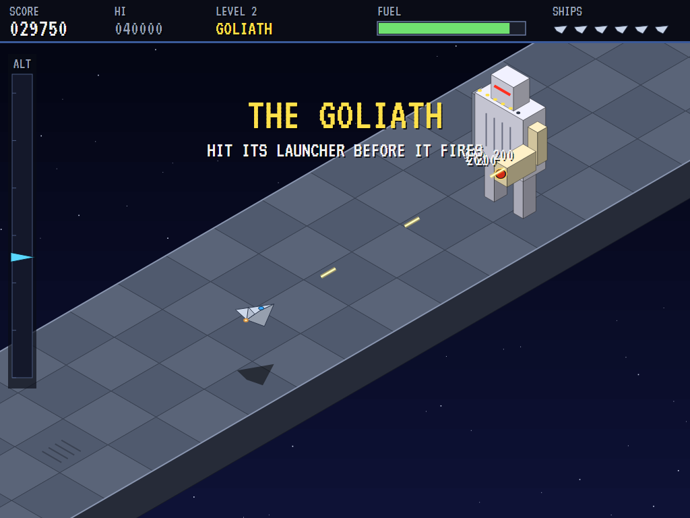 |
| A tank goes up, and the gauge with it. | Tanks, planes and silos. | Hits on the launcher. |

| Its missile | Down | Crashed |
|:-----------:|:----:|:-------:|
| 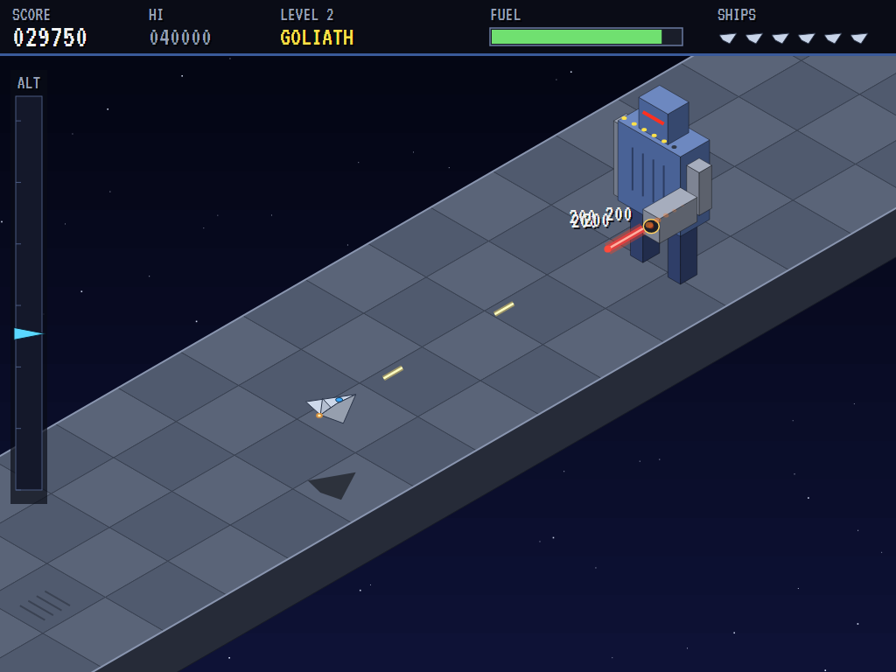 | 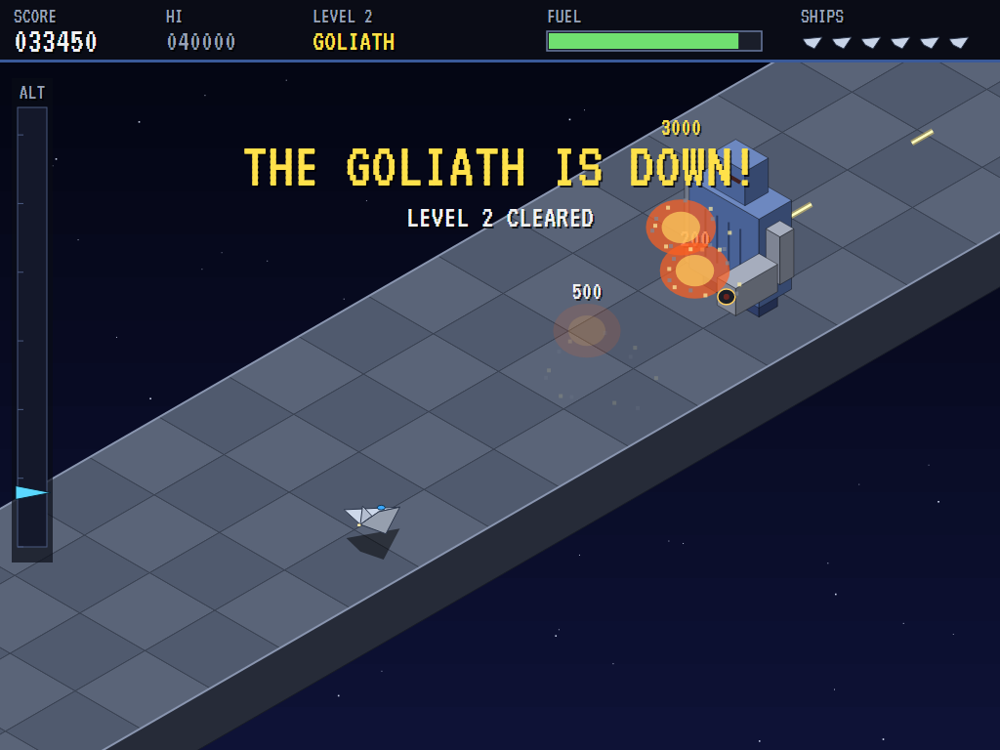 | 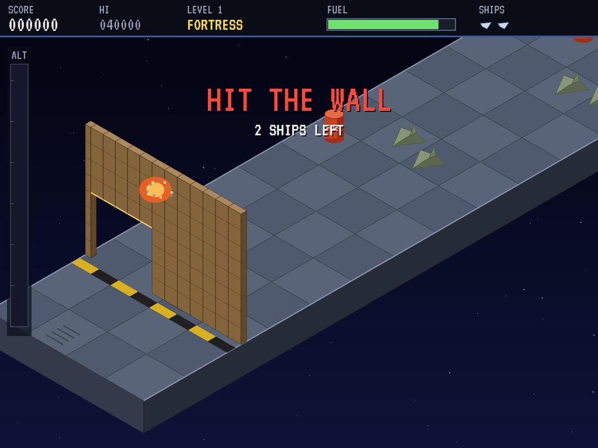 |
| Fired, and homing. | The robot falls. | Too high for the hole. |

| The best pilots | | |
|:---------------:|:-:|:-:|
| 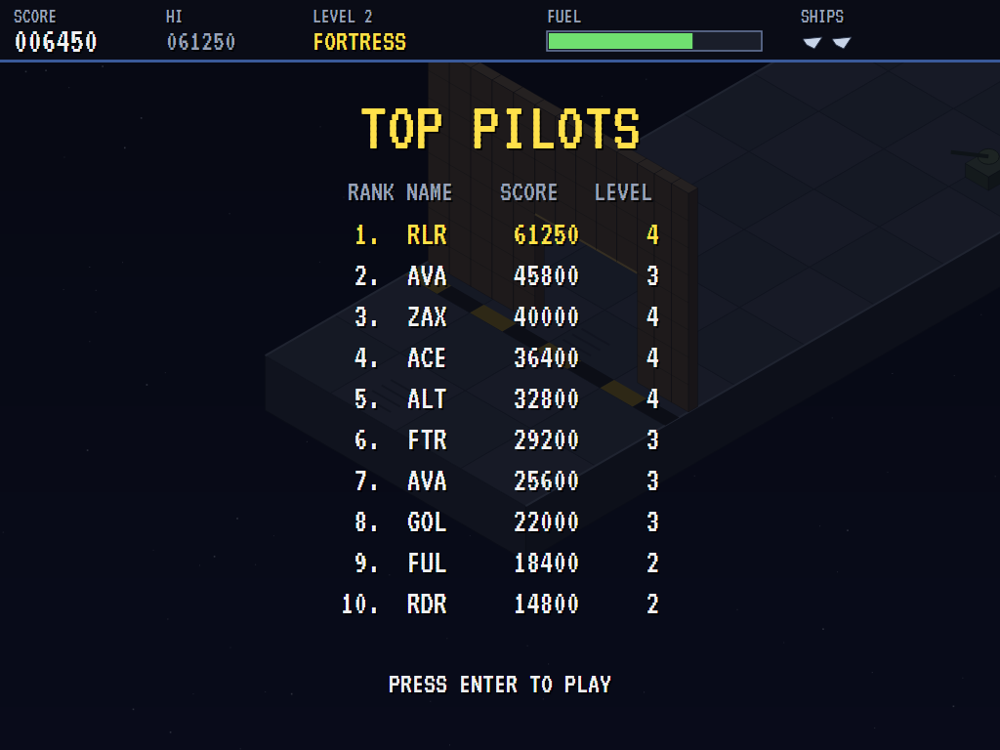 | | |
| The high-score table. | | |

The screenshots are made by the tests, which play the game in a real (headless) window; see
[Tests](#tests).

## Download and run

Ready-to-run builds for Windows, macOS and Linux, on both Intel/AMD and ARM, are on the
[Releases page](https://github.com/Harlock123/AVAZaxxon/releases/tag/latest). **Latest build** is
rebuilt on every push to `main`. Each download is one self-contained executable: no .NET install is
needed.

| Platform | Archive |
|---|---|
| Windows | `AVAZaxxon-win-x64.zip`, `AVAZaxxon-win-x86.zip`, `AVAZaxxon-win-arm64.zip` |
| macOS | `AVAZaxxon-osx-arm64.tar.gz` (Apple silicon), `AVAZaxxon-osx-x64.tar.gz` (Intel) |
| Linux | `AVAZaxxon-linux-x64.tar.gz`, `AVAZaxxon-linux-arm64.tar.gz`, `AVAZaxxon-linux-arm.tar.gz` |

```bash
tar -xzf AVAZaxxon-linux-x64.tar.gz     # or linux-arm64, linux-arm, osx-arm64, osx-x64
./AVAZaxxon
```

On Windows, unzip and run `AVAZaxxon.exe`. On macOS, if Gatekeeper refuses to open it, run
`xattr -d com.apple.quarantine AVAZaxxon` once. Run with `--no-audio` for silence.

**Sound** comes through OpenAL Soft, built in for every platform. In a virtual machine the game
detects it and uses a larger audio buffer, so the sound doesn't break up.

**Gamepads** use SDL2, which is bundled for Windows, macOS and Intel/AMD Linux. ARM Linux builds need it
installed; without it the keyboard still works:

```bash
sudo apt install libsdl2-dev            # Debian / Ubuntu / Raspberry Pi OS
sudo pacman -S --needed sdl2-compat     # Arch / Omarchy
```

## Controls

| Input | Action |
|-------|--------|
| **Enter** | Start |
| **Left** / **Right** (or **A** / **D**) | Slide across the deck (up-left and down-right on screen) |
| **Up** / **Down** (or **W** / **S**) | Climb and dive |
| **Z** / **X** / **Space** / **Ctrl** (hold) | Fire |
| **P** / **Esc** | Pause (Esc again to quit) |
| **M** | Mute |
| **Ctrl+S** / **Cmd+S** | Save a screenshot to the Pictures folder |

**Gamepad**: left stick or D-pad to fly, **A**, **B** or **X** to fire, **Start** to start and pause,
**Back** (while paused) to quit.

**Entering initials**: type letters, or dial with **Up**/**Down** and accept with **Space**; **Left** /
**Backspace** go back; **Enter** finishes.

## Tests

```bash
dotnet test AVAZaxxon.slnx
```

The engine has no UI and runs in fixed 60 Hz steps, so it plays the same at any frame rate, and a seed
always plays the same game. The tests check, mostly on an empty deck with things placed where the test
wants them:

- **Flying:** the ship's speed and limits, and the stream of shots
- **The deck:**
  - shooting low enough to hit things, and passing over them when too high
  - every target's points, and a fuel tank topping up the gauge
  - flying into things on the deck
  - walls letting you through their hole and nowhere else, and stopping shots
  - force fields to be flown under, and fuel running dry
  - guns shooting you down, and silo rockets going up and being shot
- **Space and the robot:**
  - every level running fortress, space, inner fortress, robot
  - the fighters counted down, shot or passed, and colliding with one
  - six launcher hits bringing the robot down and clearing the level
  - shots clanging off its body
  - its homing missile turning on you and being shot down, or hunting you down
- **The machine:**
  - lost ships returning, the end of the game, and the extra ship
  - fortress layouts the same every time, with fuel enough
  - the computer pilot clearing the first level without losing a ship
  - the attract cycle, the same game from the same seed, initials and the high-score file

The screenshot tests draw the real screen in a headless window. To refresh the README's pictures:

```bash
ZAXXON_SHOTS=$PWD/Images dotnet test tests/AVAZaxxon.Tests --filter ScreenshotTests
```

To see how the computer pilot gets on (for tuning):

```bash
ZAXXON_PROBE=1 dotnet test tests/AVAZaxxon.Tests --filter PilotProbe --logger "console;verbosity=detailed"
```

## Building

```bash
dotnet build AVAZaxxon.slnx
dotnet run --project src/AVAZaxxon
```

Needs the .NET 10 SDK. The sounds are made by `tools/make_sounds.py` (standard-library Python):
`python3 tools/make_sounds.py` rewrites `src/AVAZaxxon/Sounds`.

## Project structure

```
AVAZaxxon/
├── AVAZaxxon.slnx
├── src/AVAZaxxon/
│   ├── Engine/
│   │   ├── GameEngine.cs        # States, the title and demo cycle, and the music
│   │   ├── GameEngine.Play.cs   # Flying, fuel, the fortress layouts, walls and fields, guns, silos,
│   │   │                        # the fighters, the robot and its missile, scoring and lives
│   │   ├── MachinePilot.cs      # The computer pilot, for the demonstration (and the tests)
│   │   ├── Entities.cs
│   │   ├── HighScoreTable.cs, InitialsEntry.cs
│   │   ├── InputHandler.cs, ControllerManager.cs  # Keys and an SDL2 gamepad
│   │   └── SoundManager.cs      # Effects, the flying music and the tunes through OpenAL
│   ├── Audio/                   # The OpenAL engine (from the author's AVABand)
│   ├── Views/                   # The isometric view, the deck, walls, targets, ships and the robot
│   └── Sounds/                  # The synthesised effects and tunes
├── tests/AVAZaxxon.Tests/       # Gameplay, screenshot and probe tests
├── tools/make_sounds.py
└── Images/                      # Screenshots
```

## About and licence

AVA Zaxxon © 2026 Lonnie Watson, under the [MIT License](LICENSE).

*Zaxxon* © 1982 Sega; the name belongs to its current owner. AVA Zaxxon is an independent, unofficial
game in its style. Its fortresses, ships, the Goliath robot, graphics, sounds, tunes and code are its
own; nothing is taken from the arcade machine's program, graphics, sound or music. It is not
affiliated with or endorsed by any rights holder.
